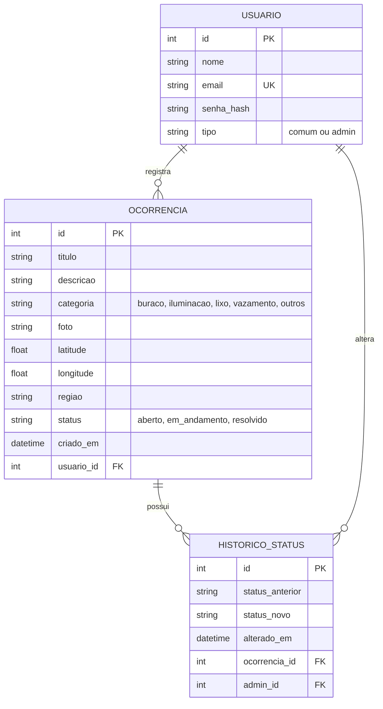

# Especificação — Cidade em Foco

Denúncias de problemas urbanos por uma cidade melhor!

## 1. Problema e escopo

**A dor real.** Moradores encontram buracos, postes apagados, lixo acumulado e vazamentos, mas não sabem a quem reclamar, não têm como provar o problema e nunca ficam sabendo se algo foi feito. A administração, por sua vez, não tem os relatos reunidos num único lugar nem uma visão de onde estão os problemas mais frequentes.

**A solução.** Um portal web onde o morador registra o problema com foto e localização e acompanha o andamento, e onde o administrador reúne todas as ocorrências, atualiza o status e consulta relatórios.

**Dentro do escopo**
- Cadastro, login e dois perfis de usuário (comum e administrador)
- Registro, edição e exclusão de ocorrências, com foto e localização
- Acompanhamento do status e histórico de alterações
- Mapa de ocorrências e relatórios
- API REST documentada com Swagger

**Fora do escopo (próximas versões)**
- Recuperação de senha por e-mail
- Notificações, comentários e avaliação do atendimento
- Várias fotos por ocorrência e escolha do local clicando no mapa
- Aplicativo para celular (o site é responsivo)

## 2. Mapa de Empatia — o morador

| | |
|---|---|
| **Pensa e sente** — "Ninguém resolve nada." Quer ser ouvido, tem receio de perder tempo e de se expor ao reclamar. | **Vê** — Ruas com buracos, postes apagados e lixo no caminho; vizinhos reclamando em grupos de mensagens; aplicativos de outras cidades com o mesmo objetivo. |
| **Ouve** — Vizinhos dizendo "já reclamei e nada mudou"; reclamações sem resposta; a ideia de que reclamar não adianta. | **Fala e faz** — Reclama em redes sociais e grupos, liga para órgãos públicos, tira foto do problema e a guarda no celular. |

**Dores:** não saber onde registrar; não conseguir provar o problema; não saber se alguém viu; não acompanhar o andamento; medo de expor dados pessoais.

**Ganhos esperados:** registrar rápido, com foto e local; acompanhar o status; ver o que outros moradores já relataram; ter a privacidade protegida.

**Validação:** _preencher com quem validou o mapa (nome ou função), a data e o que mudou depois da conversa._

### Dores e ganhos viram requisitos

| Dor ou ganho | Requisito |
|---|---|
| Não sabe onde registrar | RF03: formulário simples, com tipo, local e foto |
| Não consegue provar | RF03: foto com validação; localização por GPS |
| Não acompanha o andamento | RF05 e RF06: lista própria, status e histórico |
| Quer ver o que outros relataram | RF09: mapa da cidade com cores por status |
| Medo de exposição | RNF02 e RNF05: mapa sem dados pessoais; permissões no servidor |
| Administração sem visão geral | RF08 e RF10: painel do administrador e relatórios |

## 3. Requisitos

### Funcionais

| Código | Requisito |
|---|---|
| RF01 | O visitante pode criar uma conta com nome, e-mail e senha. Toda conta nova é do tipo comum. |
| RF02 | O usuário entra com e-mail e senha e recebe um token de acesso. |
| RF03 | O usuário logado registra uma ocorrência com tipo (buraco, iluminação, lixo, vazamento ou outros), descrição opcional, foto opcional e localização (texto e/ou coordenadas). |
| RF04 | O usuário comum vê somente as próprias ocorrências; o administrador vê todas. |
| RF05 | O usuário abre os detalhes de uma ocorrência e vê o histórico de status. |
| RF06 | O usuário filtra as próprias solicitações por status. |
| RF07 | O dono edita ou exclui a ocorrência enquanto ela estiver aberta. |
| RF08 | O administrador altera o status (aberta, em andamento ou resolvida). Cada mudança fica registrada com data e responsável. |
| RF09 | Todo usuário logado vê o mapa com os pontos das ocorrências, coloridos por status. |
| RF10 | O usuário vê relatórios: o administrador, o geral; o comum, o pessoal. Incluem totais por status, tipo e região e as regiões prioritárias. |
| RF11 | O administrador lista os usuários cadastrados. |

### Não funcionais

| Código | Requisito |
|---|---|
| RNF01 | **Segurança:** senhas guardadas com hash e salt (PBKDF2-SHA256); autenticação por token JWT; limite de 5 tentativas erradas de login a cada 5 minutos. |
| RNF02 | **Permissões no servidor:** a verificação de perfil e de dono é feita no backend, não só nos botões da tela. |
| RNF03 | **Upload seguro:** apenas JPG, PNG ou WEBP, até 5 MB, conferidos pelo conteúdo real do arquivo; nome gerado pelo sistema. |
| RNF04 | **Desempenho (meta):** as listagens respondem em até 2 segundos no uso normal do protótipo. |
| RNF05 | **Privacidade:** o mapa não expõe descrição, foto nem autor; o administrador não exibe e-mail do cidadão nas listas de ocorrência. |
| RNF06 | **Persistência:** dados em banco relacional; fotos guardadas em disco no servidor. |
| RNF07 | **Usabilidade:** interface responsiva (computador e celular), com mensagens de erro claras. |
| RNF08 | **Confiabilidade:** erros tratados em um ponto central; a API devolve mensagens e códigos HTTP corretos sem cair. |

## 4. Entidades

Relacionamentos: um usuário tem várias ocorrências; uma ocorrência tem vários registros de histórico; cada registro guarda o administrador que fez a alteração.

## 5. Rotas da API

Todas as respostas de dados são JSON. A documentação interativa fica em `/docs` (Swagger).

| Método | Rota | Quem acessa | Sucesso | Erros possíveis |
|---|---|---|---|---|
| GET | `/saude` | Público | 200 | — |
| POST | `/usuarios` | Público | 201 | 400 dados inválidos · 409 e-mail já cadastrado |
| GET | `/usuarios` | Administrador | 200 | 401 · 403 |
| POST | `/auth/login` | Público | 200 | 401 credenciais erradas · 429 muitas tentativas |
| GET | `/auth/eu` | Logado | 200 | 401 |
| POST | `/ocorrencias` | Logado | 201 | 400 dados inválidos ou arquivo que não é imagem · 401 · 413 foto grande |
| GET | `/ocorrencias` | Logado (comum vê as suas; admin vê todas) | 200 | 401 |
| GET | `/ocorrencias/{id}` | Dono ou administrador | 200 | 401 · 404 |
| PUT | `/ocorrencias/{id}` | Dono, ocorrência aberta | 200 | 400 · 401 · 404 · 409 não está aberta · 413 |
| DELETE | `/ocorrencias/{id}` | Dono, ocorrência aberta | 204 | 401 · 404 · 409 não está aberta |
| PATCH | `/ocorrencias/{id}/status` | Administrador | 200 | 400 status inválido · 401 · 403 · 404 |
| GET | `/mapa` | Logado | 200 | 401 |
| GET | `/relatorios` | Logado (admin: geral; comum: pessoal) | 200 | 401 |

As fotos ficam em `/uploads/<nome>`. O nome é aleatório e difícil de adivinhar.

## 6. Critérios de aceite

| Cenário | Resultado esperado |
|---|---|
| Cadastrar com dados válidos | 201 e o usuário volta **sem** senha nem hash |
| Cadastrar enviando `"tipo": "admin"` | A conta é criada como `comum` |
| Cadastrar com e-mail já usado | 409 com mensagem clara |
| Cadastrar com senha de menos de 6 caracteres | 400 |
| Login com senha errada | 401 "E-mail ou senha incorretos." |
| 6 logins errados seguidos | A 6ª tentativa recebe 429 |
| Acessar qualquer rota protegida sem token ou com token adulterado | 401 |
| Criar ocorrência válida, com ou sem foto | 201; a foto sai do disco se o banco falhar |
| Criar ocorrência sem localização | 400 |
| Enviar arquivo `.txt` renomeado para `.jpg` | 400 |
| Enviar imagem maior que 5 MB | 413 |
| Usuário comum lista ocorrências | Recebe só as suas |
| Usuário comum abre a ocorrência de outro | 404 |
| Comum tenta alterar o status | 403 |
| Administrador altera o status | 200 e o histórico ganha um registro com o nome do admin |
| Dono vê o histórico da própria ocorrência | Vê as mudanças **sem** o nome do administrador |
| Dono edita ocorrência aberta | 200 com os dados novos; a foto antiga é apagada ao ser trocada |
| Dono edita ou exclui ocorrência em andamento | 409 |
| Outro usuário (ou o admin) tenta editar ou excluir | 404 |
| Dono exclui ocorrência aberta | 204; a ocorrência, o histórico e a foto somem |
| Consultar `/mapa` | Apenas id, categoria, status, região e coordenadas; sem foto, descrição ou autor |
| Relatório do administrador | Soma de todas as ocorrências; regiões prioritárias ordenadas pelas não resolvidas |
| Relatório de usuário comum | Soma só das ocorrências dele |
| Consultar `/saude` | 200 `{"status": "ok"}` |

## 7. Limitações conhecidas

- Banco SQLite e fotos em disco local: adequados ao protótipo, mas precisam de banco em nuvem em produção.
- Sem recuperação de senha por e-mail.
- O limite de tentativas de login fica na memória e zera quando o servidor reinicia.